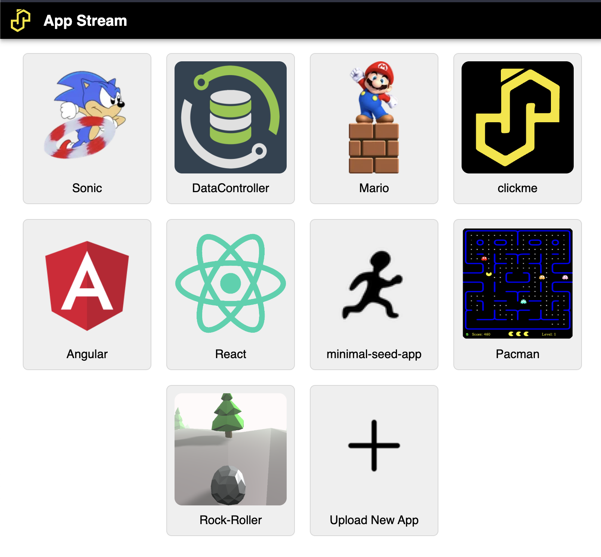

# App Stream

AppStream is the gateway to apps on SASjs Server.

{ width="1608" height="1490" loading="lazy" decoding="async" }

## Creating Apps

Anybody can create an app for SASjs Server - it just needs to be compiled using the [SASjs CLI](https://cli.sasjs.io/compile).  The output of this process is a zip file that can be imported to any SASjs Server instance.

## Deploying Apps

An administrator publishes an app from Administration, in the "Publish an app" card: choose the zip a `sasjs build` produced and it is written to the drive and streamed at `/app/<id>/`. Nothing else on the server publishes an app from the browser - the card is the one action the App Stream page used to carry.

Alternative deployment approaches include:

* `sasjs deploy` - [https://cli.sasjs.io/deploy/](https://cli.sasjs.io/deploy/)
* Use the `/SASjsApi/drive/deploy/upload` API
* Use the `/SASjsApi/drive/deploy` API

### Deployment limits

A deploy is measured before anything is written, and refused with `413` when the tree is over any of these:

| Limit | Value |
| --- | --- |
| Entries | 10,000, folders included |
| Total size | 100 MB, decoded |
| A single file | 20 MB |

The refusal names the limit and the figure it reached, for example `The file tree exceeds the deploy limit: 10001 entries (maximum 10000).` Nothing is written before the checks pass, so a refused deploy leaves the drive exactly as it was.

Sizes are decoded bytes. A file member travels as its own text, or as base64 when it says `encoding: "base64"` - four characters for every three bytes - so a tree at the total limit with binary members is up to a third larger on the wire than on the drive, and the transport admits that much. `POST /SASjsApi/drive/deploy/upload` applies the same limits to the tree it unpacks from the archive, not to the archive itself.

Member names are checked in the same pass: a name carrying `/`, `\` or `..` would write outside the deployment folder, so the tree is refused with `400` instead.

A file that is not an archive is refused with `400` before it is read, and the refusal names the file and quotes what it holds: `The file "server.json.zip" is not a zip archive: it begins with "------formdata-undici-...", where a zip archive begins with the four bytes "PK\x03\x04".` A download served under a `.zip` name is not always one - a release asset uploaded as the multipart body that carried it begins with the form boundary - and an archive that begins with the signature but cannot be read keeps the reader's own reason, attached to the file's name. Both are `400`, because the request is what needs correcting. A file that stops inside the signature is refused as what it is, with the number of bytes it holds.

## Publishing an app

The simplest publish is the compiled frontend itself: a zip of the folder a browser opens, with `name` giving the app its identity.

```bash
# the archive holds what the browser is served - index.html, app.js, assets/logo.png
curl -X POST "https://my-server/SASjsApi/drive/deploy/upload?name=harness" \
  -H "Authorization: Bearer ***" \
  -F "file=@harness.zip"
```

The entries become `apps/<name>` on the drive, and the app opens at `/app/<name>/`. The name is the app's key, its folder and its address, so it has to be usable as one URL segment - see [The app's id, and the name it is known by](#the-apps-id-and-the-name-it-is-known-by).

An archive whose entries all sit inside one folder is a folder that was compressed rather than its contents - `myapp/index.html` rather than `index.html` - and the folder is dropped, so the app is served at the root of `apps/<name>` rather than one level down. The folders a deployment is made of (`services`, `web`, `backend`) are never treated that way: an archive holding one of those at its root is a tree whose root that is. A request that names the folder it deploys to (`?appLoc=`) keeps the wrapper, because that route [keeps the archive's structure](#publishing-a-frontend-and-its-backend).

An archive that names no destination is refused with `400`, and the refusal names the file, what it lacks and how to supply it: `The archive "site.zip" names no destination to deploy to: it carries no sasjs.app.json at its root, and the request states neither "name" nor "appLoc". Publish the zip a sasjs build writes, which states the destination itself, or add ?name=<app> to publish this archive as an app, or ?appLoc=/<folder> to deploy its files to a folder.`

## Publishing a frontend and its backend

A bundle can carry both halves, and that is what `sasjs build` writes for a server target:

```
macrodash.zip
  sasjs.app.json        {"name": "macrodash", "appLoc": "/Public/app/macrodash"}
  web/                  the compiled frontend
  backend/              the services the frontend calls (optional)
```

One upload deploys the backend and publishes the frontend:

```bash
curl -X POST "https://my-server/SASjsApi/drive/deploy/upload" \
  -H "Authorization: Bearer ***" \
  -F "file=@macrodash.zip"
```

* The CONTENTS of `web/` become `apps/<name>`, replacing what that folder held: the folder is the container, not part of the app, and the bundle says what it holds.
* The CONTENTS of `backend/` are written to `appLoc`, **replacing** it. The folder becomes what this bundle carries, so a service the new bundle dropped stops being served rather than staying reachable with nothing naming it.
* `sasjs.app.json` is metadata: it is read before anything is written, and it is never served with the app.

Two frontends can share one backend. Publish each with the same `appLoc` and a different `name`: each is its own app with its own id and URL, and neither deploy touches the other's frontend. The backend itself is replaced by whichever bundle carries it, so a shared folder holds the services of the last bundle to deploy there - deploy them in order, and a service lost that way is one `DELETE /SASjsApi/drive/file` will not find.

## The older shape

A deployment built before apps were frontends is published with the folder and the stream in the query, and keeps working unchanged:

```bash
# the archive holds services/web/index.html, services/web/app.js, assets/logo.png
curl -X POST "https://my-server/SASjsApi/drive/deploy/upload?appLoc=/Public/apps/harness&streamWebFolder=web" \
  -H "Authorization: Bearer ***" \
  -F "file=@harness.zip"
```

The archive's structure is kept under `appLoc`, a single top-level folder included - a zip holding `mysite/index.html` deploys to `<appLoc>/mysite/index.html`. The unwrap described under [Publishing an app](#publishing-an-app) is what a publish does, not what a deploy to a named folder does. `streamWebFolder` publishes that folder as an App Stream app, and `streamServiceName` sets its label. Such an app is served from `<appLoc>/services/<streamWebFolder>`, so that is where its entry page lives - the example above holds `services/web/index.html` - and a request that names `streamWebFolder` must carry that folder, or it is refused with a message naming it rather than deployed.

A zip that contains a deploy document - a root-level JSON file naming `appLoc` and `fileTree` - is read as a document instead, so the route answers both shapes. `sasjs.app.json` is never read as one, even though it names an `appLoc`: it is the bundle's own manifest. A JSON file the app itself ships, such as a manifest or a data file, names neither and is deployed with the rest.

Two kinds of entry are dropped, because macOS adds them to an archive of a folder and they are not part of the app: anything under `__MACOSX/`, and `.DS_Store`.

### The app's id, and the name it is known by

A publish gives an app its identity. The first publish of an app mints a UUID, and that id is the app: its URL is `/app/<id>/`, a removal names it, and a redeploy keeps it - so a new bundle never moves an app's URL. The deploy answer states it as `app: { id, name, url }`.

For an app published as a frontend the name is the key as well as the label: it is the folder (`apps/<name>`), the address (`/app/<name>/`) and what the tile says, so it has to be usable as one URL segment - letters, digits, dot, dash, underscore or tilde, starting with a letter or digit, at most 64 characters, and not `apps.json` or `index.html`, which the App Stream answers itself. A publish that states anything else is refused with `400`, and one that names an app another app already holds is refused with `409`. A rename is therefore a new app: publish under the new name, delete the old one.

A legacy entry is keyed by its folder, and its name is a label and only a label: `streamServiceName` sets it, two folders may both be called `report`, and the name is derived from the last segment of `appLoc` when the publish states none.

### The bundle's manifest

A bundle may describe itself, in `sasjs.app.json` at the root of the archive:

```json
{
  "name": "Dashboard",
  "appLoc": "/Public/app/dashboard",
  "logo": "assets/logo.png",
  "frameAncestors": ["https://example.com"]
}
```

`name` says which app the frontend is and `appLoc` which backend it calls; both are optional in the file, because the request may state them instead. `streamWebFolder` states the older shape - a manifest carrying it publishes the legacy way, with the web assets under `<appLoc>/services/<streamWebFolder>` - and is what an older CLI writes. The manifest describes the app rather than serving it, so it is read and left out of the deployment, and the request wins where both speak: a caller naming a folder, a name or a label is correcting the archive.

A legacy bundle states `appLoc` in its manifest as well, because that shape deploys one tree to one folder: `streamWebFolder` says where inside the folder the web assets sit, and `appLoc` says which folder. `sasjs build` writes both from the target, so the zip it produces can be published on a host that has nothing but the archive - including one uploaded by hand. A manifest that states `streamWebFolder` and no `appLoc` is refused with `400`: `"appLoc" is required when "streamWebFolder" is stated: the entry keeps its web assets at <appLoc>/services/<streamWebFolder>, so both halves are needed to say where they are.`

### Removing an app

`DELETE /AppStream/<id>` - or `/app/<id>`, which is the same surface - and `DELETE /SASjsApi/drive/deploy` with `{ "id": "<id>" }` do the same thing: the app stops being advertised and stops being served.

An app published as a frontend is its folder, so unpublishing removes `apps/<name>` with the entry. A legacy entry's files sit inside a backend folder that may serve other apps, so those are left where they are, and the folder goes with `DELETE /SASjsApi/drive/folder` by whoever owns the deployment.

### Replacing the folder

`POST /SASjsApi/drive/deploy` takes `replace: true` to write the tree as the folder's whole contents: the folder is removed before the tree is written, so a file the new version renamed or dropped stops being served. An archive upload replaces by default - publishing a frontend means `apps/<name>` is what the archive says it is - and `?replace=false` keeps what is already there.

A package's backend is written on the same terms whichever way `replace` is set: the bundle carries the folder's contents, so the folder is made to match it.

The removal happens after the tree is accepted, so a request that is going to be refused never deletes anything. A folder can hold more than one published app, and replacing it empties the folder rather than just the app being deployed - so several frontends may name one `appLoc`, but each deploy of that backend rewrites it and the last bundle to carry it is what the folder holds. Keeping a folder two bundles both write is about deploying them in order, not merging them.

### Text and binary file members

A `file` member carries the caller's own text by default. An asset that is not text states `encoding: "base64"`, and its `code` is base64 of the bytes to write:

```json
{
  "members": [
    { "name": "index.html", "type": "file", "code": "<h1>Hello</h1>" },
    { "name": "logo.png", "type": "file", "encoding": "base64", "code": "iVBORw0..." }
  ]
}
```

Nothing is guessed from the contents: `test` and `data` are both valid base64, so a guess would corrupt short text rather than decode a file. An archive upload marks every entry `base64`, because an archive holds bytes.

A deploy document written by a client older than `@sasjs/api` 0.24 states no `encoding` and carries its files as base64, which this server now reads as text - so such a document has to add `encoding: "base64"` to each `file` member. The CLI states it for the assets it builds.

## The app's URL

An app answers on two URLs.

- `/AppStream/<id>` - the id is a UUID, minted at the first publish and kept when the app is published again, so this URL survives a redeploy.
- `/AppStream/<name>` - the readable form, which is what a person shares. An app published as a frontend holds its name uniquely, so this address is always available to it. A legacy entry's name may be shared, and an ambiguous one answers `404` rather than guessing which app was meant.

The id is what the permission model speaks, and it is the handle every removal names. A rename does not exist: an app published as a frontend IS its name, so a new name is a new app.

## A streamed build, served from Drive

A build made with `streamWeb` in the target's `streamConfig` (`sasjs web`, or `sasjs cbd`) writes an entry page whose every asset link names the file by path:

```
<script src="/StoredProgram?_FILE=/Public/4gl/myapp/services/web/main.4f3a9c1d.js"></script>
```

`/StoredProgram` is the web tier this server serves a build from: a browser fetches a filename from it, and the file comes back - one file out of the Drive, typed by its extension, so a page, a script, a stylesheet or a font arrives as itself rather than as bytes. Nothing has to be unpacked or mounted first, which is why a frontend built to name its assets this way can be deployed to the Drive at the `appLoc` it carries and opened here unchanged.

`/StoredProgram` answers a second parameter: `_program=<path>` runs a stored program on the same address. A request naming both `_program` and `_FILE` is refused with `400`, because the two answer different things, and the refusal names both parameters rather than resolving one over the other. That refusal is one sentence with one copy per side: this server mints it in `api/src/routes/setupRoutes.ts` as `TIER_NEEDS_ONE_PARAMETER`, and the mocked host in sasjs/cli (`src/commands/build/internal/mockSite/assets/sw.js`) answers it verbatim, each pinned by its own spec, so a rewording cannot land on one side alone.

What both parameters share is everything that decides access: the rule on `/SASjsApi/drive/file` governs them, so a caller who may not read the Drive reads no asset and runs no program, and a path that climbs out of the Drive is refused with `400`. A file that is not there answers `202` with `Parameter Error` and `File error` rather than a `404`, so a missing asset looks the same however it was asked for. Hashed asset names are cached immutably and everything else revalidates, as they are on an app's own route.

Where the assets land is the build's business, not this server's: a target with `streamWeb` set writes the folder itself and is opened at `<server>/StoredProgram?_FILE=<appLoc>/services/<streamServiceName>.html`.

## One pack, either run time

A SASjs Server runs programs as SAS or as JavaScript, chosen by `RUN_TIMES`. A deployment can carry both: the SAS service `services/common/configure` and the JS program `services/common/configure.js` sit side by side under the app's folder, and the run time decides which one runs. A pack built for a server that runs JS - the `server` target of a SASjs app with its JS mocks in `serviceFolders` - therefore works on either without a second build, and a browser-hosted site (which is a JS host) runs the same programs.

## Securing Apps

If you are running in "Server" mode you can grant permissions at the level of User or Group to any uploaded application - just click on your username, then "Settings", then "Permissions", to create the necessary rule(s).

An app's route names its ID, `/AppStream/<id>`, and the rule has to be written that way even when the URL a person opens shows the name (`/app/<name>/`): the permission is keyed on the id route, so a rule on `/AppStream/macro-dash` matches no route and grants nothing.


## Available Apps

SASjs Server does not have an in-built "app store" (due to our security policy of having no external web requests), however you may download apps yourself from the following locations and upload them to your SASjs Server instance.

### Productivity Apps
#### Data Controller for SAS®

[Data Controller](https://datacontroller.io) is a full-blown SAS application to provide business users with a carefully-controlled capability to make changes to data in SAS.

The app can be downloaded from here: [https://git.4gl.io/dc/deploy/raw/branch/main/server.json.zip](https://git.4gl.io/dc/deploy/raw/branch/main/server.json.zip).

Documentation is here: [https://docs.datacontroller.io](https://docs.datacontroller.io).

### Seed Apps

The following apps are presented as "starter packs" with which you can build your own SASjs App:

#### Angular Seed App

A demo app built using Angular.  Builds are published to the [releases page](https://github.com/sasjs/angular-seed-app/releases).

#### Minimal Seed App

This is a simple demo app built with Vanilla JS and SAS.  You can find the latest version on the github [releases page](https://github.com/sasjs/minimal-seed-app/releases)

#### React Seed App

The primary template used by the [SAS Apps team](https://sasapps.io).  Artefacts available on the [releases](https://github.com/sasjs/react-seed-app/releases) page.

### Games

The serious part of the game series is that you can see how easy it is to deploy generic web apps to SASjs Server - or any SAS server for that matter!

#### Macro Dash

Bounce through the WORK library, stomp the ERRORs and get the report out before the job runs out of steam. The leaderboard is a set of SAS services, so the game shows the full backend - not just a streamed frontend. Play it at [https://dash.sasjs.io](https://dash.sasjs.io); the SASjs Server service pack and the Viya deploy script are on the [releases](https://github.com/sasjs/macro-dash/releases) page.

#### Mario

Needs no introduction. Release assets available here: [https://github.com/sasjs/mario/releases](https://github.com/sasjs/mario/releases)

#### Pacman

Another video game classic! Release assets are available here: [https://github.com/sasjs/pacman/releases](https://github.com/sasjs/pacman/releases)

#### Rock Roller

Dodge the trees and move down the slope! Release assets are available here: [https://github.com/sasjs/rockroller/releases](https://github.com/sasjs/rockroller/releases).
