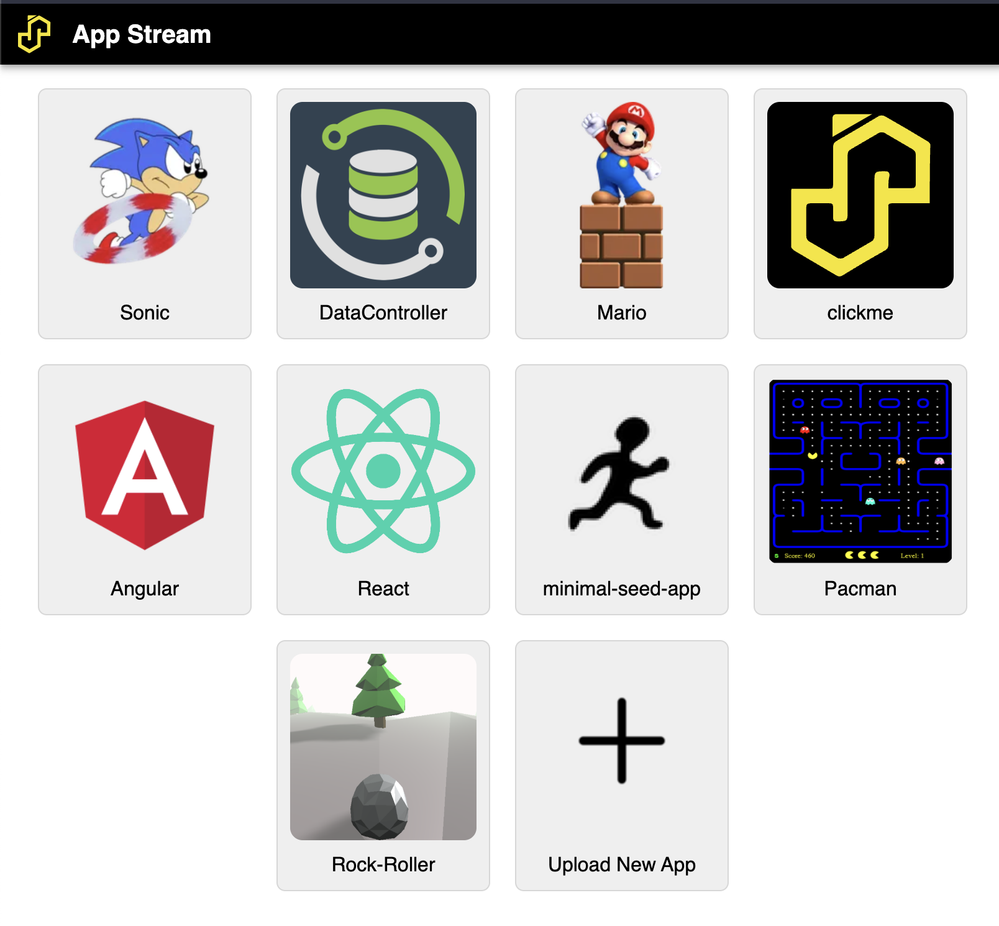

# App Stream

AppStream is the gateway to apps on SASjs Server.

{ width="1608" height="1490" loading="lazy" decoding="async" }

## Creating Apps

Anybody can create an app for SASjs Server - it just needs to be compiled using the [SASjs CLI](https://cli.sasjs.io/compile).  The output of this process is a zip file that can be imported to any SASjs Server instance.

## Deploying Apps

Simply click the "Upload New App" button and select the local zip file containing the app you wish to deploy.

Alternative deployment approaches include:

* `sasjs deploy` - [https://cli.sasjs.io/deploy/](https://cli.sasjs.io/deploy/)
* Use the `/SASjsApi/drive/deploy/upload` API
* Use the `/SASjsApi/drive/deploy` API

### Deployment limits

A deploy is measured before anything is written, and refused with `413` when the tree is over any of these:

| Limit | Value |
| --- | --- |
| Entries | 10,000, folders included |
| Total size | 100 MB, decoded |
| A single file | 20 MB |

The refusal names the limit and the figure it reached, for example `The file tree exceeds the deploy limit: 10001 entries (maximum 10000).` Nothing is written before the checks pass, so a refused deploy leaves the drive exactly as it was.

Sizes are decoded bytes. A file member travels as its own text, or as base64 when it says `encoding: "base64"` - four characters for every three bytes - so a tree at the total limit with binary members is up to a third larger on the wire than on the drive, and the transport admits that much. `POST /SASjsApi/drive/deploy/upload` applies the same limits to the tree it unpacks from the archive, not to the archive itself.

Member names are checked in the same pass: a name carrying `/`, `\` or `..` would write outside the deployment folder, so the tree is refused with `400` instead.

## Publishing a folder of files

An app does not need a compiled service pack. `POST /SASjsApi/drive/deploy/upload` takes a zip whose entries are the files to serve:

```bash
# the archive holds the app's files, rooted where the server serves them from:
#   services/web/index.html, services/web/app.js, assets/logo.png
curl -X POST "https://my-server/SASjsApi/drive/deploy/upload?appLoc=/Public/apps/harness&streamWebFolder=web" \
  -H "Authorization: Bearer $TOKEN" \
  -F "file=@harness.zip"
```

The archive's structure is kept under `appLoc`. What a deploy document would have said comes from the query: `appLoc` is required, `streamWebFolder` publishes that folder as an App Stream app, and `streamServiceName` names it.

An app is served from `<appLoc>/services/<streamWebFolder>`, so that is where its entry page lives - the example above holds `services/web/index.html`. The same rule holds for `POST /SASjsApi/drive/deploy` with a JSON tree: a request that names `streamWebFolder` must carry that folder, and is refused with a message naming it rather than deployed, because publishing it would advertise an app that resolves to nothing.

A zip that contains a deploy document - a root-level JSON file naming `appLoc` and `fileTree` - is read as a document instead, so the route answers both shapes. A JSON file the app itself ships, such as a manifest or a data file, is not a document and is deployed with the rest.

Two kinds of entry are dropped, because macOS adds them to an archive of a folder and they are not part of the app: anything under `__MACOSX/`, and `.DS_Store`.

### The name an app is published under

When `streamServiceName` is absent, the name is the last segment of `appLoc` - `/Public/apps/dashdemo` publishes as `dashdemo`. A segment that cannot be a URL path is reduced to one (`My App` becomes `My-App`), and a name already held by a different folder gains a short digest of its folder (`dashdemo-3f9a1c`), so two apps whose folders end in the same word do not overwrite each other. The same folder always derives the same name.

### Replacing the folder

`POST /SASjsApi/drive/deploy` takes `replace: true` to write the tree as the folder's whole contents: the folder is removed before the tree is written, so a file the new version renamed or dropped stops being served. An archive upload replaces by default - publishing a folder means the folder is what the archive says it is - and `?replace=false` keeps what is already there.

The removal happens after the tree is accepted, so a request that is going to be refused never deletes anything. A folder can hold more than one published app, and replacing it empties the folder, not just the app being deployed.

### Text and binary file members

A `file` member carries the caller's own text by default. An asset that is not text states `encoding: "base64"`, and its `code` is base64 of the bytes to write:

```json
{
  "members": [
    { "name": "index.html", "type": "file", "code": "<h1>Hello</h1>" },
    { "name": "logo.png", "type": "file", "encoding": "base64", "code": "iVBORw0..." }
  ]
}
```

Nothing is guessed from the contents: `test` and `data` are both valid base64, so a guess would corrupt short text rather than decode a file. An archive upload marks every entry `base64`, because an archive holds bytes.

## Securing Apps

If you are running in "Server" mode you can grant permissions at the level of User or Group to any uploaded application - just click on your username, then "Settings", then "Permissions", to create the necessary rule(s).


## Available Apps

SASjs Server does not have an in-built "app store" (due to our security policy of having no external web requests), however you may download apps yourself from the following locations and upload them to your SASjs Server instance.

### Productivity Apps
#### Data Controller for SAS®

[Data Controller](https://datacontroller.io) is a full-blown SAS application to provide business users with a carefully-controlled capability to make changes to data in SAS.

The app can be downloaded from here: [https://git.4gl.io/dc/deploy/raw/branch/main/server.json.zip](https://git.4gl.io/dc/deploy/raw/branch/main/server.json.zip).

Documentation is here: [https://docs.datacontroller.io](https://docs.datacontroller.io).

### Seed Apps

The following apps are presented as "starter packs" with which you can build your own SASjs App:

#### Angular Seed App

A demo app built using Angular.  Builds are published to the [releases page](https://github.com/sasjs/angular-seed-app/releases).

#### Minimal Seed App

This is a simple demo app built with Vanilla JS and SAS.  You can find the latest version on the github [releases page](https://github.com/sasjs/minimal-seed-app/releases)

#### React Seed App

The primary template used by the [SAS Apps team](https://sasapps.io).  Artefacts available on the [releases](https://github.com/sasjs/react-seed-app/releases) page.

### Games

The serious part of the game series is that you can see how easy it is to deploy generic web apps to SASjs Server - or any SAS server for that matter!

#### Macro Dash

Bounce through the WORK library, stomp the ERRORs and get the report out before the job runs out of steam. The leaderboard is a set of SAS services, so the game shows the full backend - not just a streamed frontend. Play it at [https://dash.sasjs.io](https://dash.sasjs.io); the SASjs Server service pack and the Viya deploy script are on the [releases](https://github.com/sasjs/macro-dash/releases) page.

#### Mario

Needs no introduction. Release assets available here: [https://github.com/sasjs/mario/releases](https://github.com/sasjs/mario/releases)

#### Pacman

Another video game classic! Release assets are available here: [https://github.com/sasjs/pacman/releases](https://github.com/sasjs/pacman/releases)

#### Rock Roller

Dodge the trees and move down the slope! Release assets are available here: [https://github.com/sasjs/rockroller/releases](https://github.com/sasjs/rockroller/releases).
