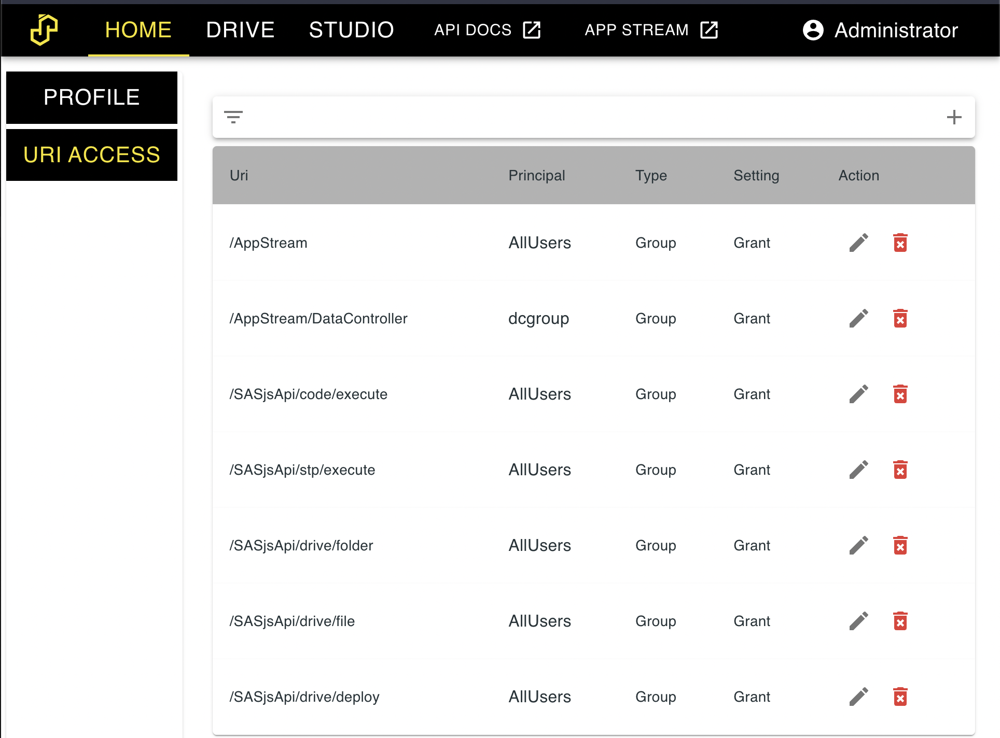

# Permissions

Permissions in SASjs are enabled when `MODE=server`.   Rules do not apply to admin users.  The menu is available under SETTINGS, and is divided into "URI Access" and "Folder Access".  Rules can be at GROUP or USER level.

The hierarchy of rules is as follows:

* By default, deny all
* Apply group grants
* Apply group deny
* Apply user grants
* Apply user deny

{ width="1928" height="1424" loading="lazy" decoding="async" }

## URI Access

URI rules can be applied to the following endpoints:

* /AppStream
* /SASjsApi/code/execute
* /SASjsApi/stp/execute
* /SASjsApi/drive/deploy
* /SASjsApi/drive/deploy/upload
* /SASjsApi/drive/file
* /SASjsApi/drive/folder
* /SASjsApi/drive/fileTree
* /SASjsApi/permission

They can also be applied to individual apps.  This part of the list is dynamically generated, for example:

* /AppStream/9f1c2d3e-4a5b-4c6d-8e7f-8a9b0c1d2e3f
* /AppStream/2b7d4e1a-6c3f-4d8e-9a0b-1c2d3e4f5a6b

An app's route names its id, which is the last segment of its URL.  A rule written before apps had an id names the app's label instead (`/AppStream/Mario`), and is still honoured: where a caller's rules speak about an id the id decides, and only when no rule names the id does the label decide.

## Folder Access

Coming soon.

