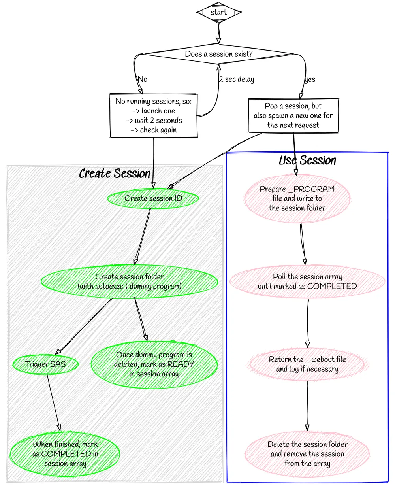

# Sessions

A session occurs in a session folder, and may be executed using either a SAS or a JS runtime.  The session folder will contain any uploaded files, as well as the program / script being executed (prepended with code to enable relevant variables, such as URL parameters).

The program itself will write the output to `_webout`, setting the header properties in a file, the location of which is in the `sasjs_stpsrv_header_loc` variable.

## SAS Runtime

In triggering the SAS executable, there are two factors that need to be overcome:

1. The process is expensive to launch (startup cost)
2. Once launched, the process will run until the end and cannot be 'communicated' with directly

To improve responsiveness, it is critical to prelaunch SAS sessions.  But how to provide an arbitrary SAS program to a running SAS session (without impacting the session itself)?

The solution, was to take the following steps:

1. Launch SAS with an autoexec and a dummy program (SAS won't start without SYSIN)
2. Delete the dummy file in the autoexec, then loop until the "real" program appears

The actual SAS code used for this:

```sas
data _null_;
  /* remove the dummy SYSIN */
  length fname $8;
  rc=filename(fname,getoption('SYSIN') );
  if rc=0 and fexist(fname) then rc=fdelete(fname);
  rc=filename(fname);
  /* now wait for the real SYSIN */
  slept=0;
  do until ( fileexist(getoption('SYSIN')) or slept>(60*15) );
    /* check every 100ms if the file exists yet */
    slept=slept+sleep(0.1,1);
  end;
run;
```

With this loop in place, SASjs Server can prespawn a SAS session and wait until a request arrives. It will then perform the following in parallel:

1. Spawn a new session (ready for the next request)
2. Inject the _PROGRAM code into an existing (HOT) session

This is a simplistic overview.  In reality it's a bit more complicated as we need to create a unique folder for each session, keep track of the sessions, and ensure we don't launch a session that is just about to expire.  We also need to work across multiple threads.

The full process flow is therefore as follows:

<!--
# https://sketchviz.com
# http://www.graphviz.org/content/cluster
digraph G {
  graph [fontname = "Handlee"];
  node [fontname = "Handlee"];
  edge [fontname = "Handlee"];

  bgcolor=transparent;

  subgraph cluster_0 {
    style=filled;
    color=lightgrey;
    node [style=filled,color=green];
    a0 -> a1 -> a2 -> a4;
    a1 -> a3
    label = "*Create Session*";
    fontsize = 20;
  }

  subgraph cluster_1 {
    node [style=filled, color=pink];
    b0 -> b1 -> b2 -> b3;
    label = "*Use Session*";
    fontsize = 20;
    color=blue
  }

  start [shape=Mdiamond];
  sessExist [shape=diamond label="Does a session exist?"]
  noSess [shape=Box label="No running sessions, so:\n-> launch one\n-> wait 2 seconds\n-> check again"]
  sess [shape=Box label="Pop a session, but\nalso spawn a new one for\nthe next request"]
  a0 [label="Create session ID"]
  a1 [label="Create session folder \n (with autoexec & dummy program)"]
  a2 [label="Trigger SAS"]
  a3 [label="Once dummy program is\ndeleted, mark as READY\nin session array"]
  a4 [label="When finished, mark\nas COMPLETED in\nsession array"]

  b0 [label="Prepare _PROGRAM\nfile and write to\nthe session folder"]
  b1 [label="Poll the session array\nuntil marked as COMPLETED"]
  b2 [label="Return the _webout file\nand log if necessary"]
  b3 [label="Delete the session folder\nand remove the session\nfrom the array"]

  start -> sessExist
  sessExist:w -> noSess [label="No"]
  sessExist:e -> sess [label="yes"]
  noSess -> a0
  sessExist:s -> noSess:e [dir=back label="2 sec delay"]
  sess -> a0
  sess -> b0
}

-->

{ width="1000" height="1237" loading="lazy" decoding="async" }


## JS Runtime

JS sessions are not pre-spawned, as NodeJS is already running.  URL variables are injected into the beginning of the program as constants.

## Reading a session's results

A triggered program keeps running after the trigger call returns, so the results are fetched from the session rather than from a response body. Three endpoints serve them while the session is alive:

| Endpoint | Returns |
|---|---|
| `GET /SASjsApi/session/{sessionId}/log` | the program's log, as `text/plain` |
| `GET /SASjsApi/session/{sessionId}/output` | its `_webout`, with the content type the program set in `stpsrv_header.txt` |
| `GET /SASjsApi/session/{sessionId}` | the session itself: state, `pid` while it runs, timestamps, `failureReason`, and the retention window |

`GET /SASjsApi/session/{sessionId}/state` answers an object rather than a bare string:

```json
{ "state": "running" }
```

That is the shape a Viya caller already polls from the compute API, so a client can be written once for both. The states are `initialising`, `pending`, `running`, `completed` and `failed`.

An empty log body is not the same as a missing one. Empty means the program has not written anything yet, while a `404` means the session no longer exists - which is what an expired session answers, because there is nothing left to read.

Each session belongs to the user that created it, recorded when the session is made. The log, the output and the details are served to that user, or to an administrator; anyone else receives a `404`, because a session id is guessable and confirming it would confirm the guess. In desktop mode the single fixed local user owns every session.

Results outlive the session for a limited time. `expiresAfterMins` on the trigger call asks to keep them that many minutes past completion; without it the folder is removed about 15 minutes after creation. A session id is therefore not a durable handle - fetch the log before the window closes, or copy it somewhere the server does not manage.
