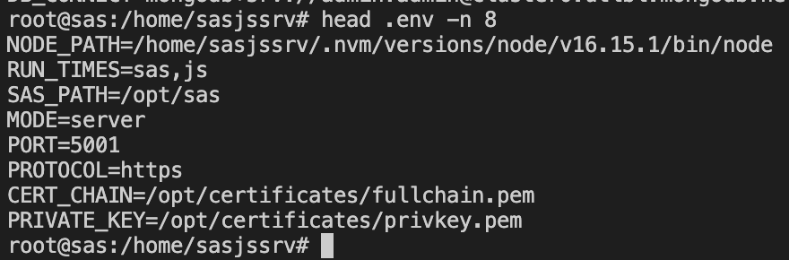
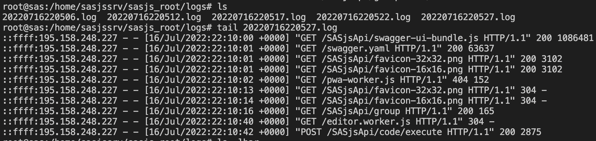

# Settings

All settings in SASjs server are made by means of environment variables.  These can be set in the following places:

- Configured globally in `/etc/environment` file
- Export in terminal or shell script (export VAR=VALUE)
- Prepended in the command
- Enter in the `.env` file alongside the executable

The usual / preferred method is to provide the variables in the `.env` file (which works on both Windows & Linux) as follows:

{ width="880" height="290" loading="lazy" decoding="async" }

In a server environment, it is highly recommended to protect this file with appropriate permissions (eg, to prevent changes being made by the shared identity under which the server is launched) 

## Environment Variables

### ADMIN_PASSWORD_INITIAL

Defines the initial (temporary) password for the `ADMIN_USERNAME`, which is in place until the first login.  There is no default: a default would ship a publicly-known credential.  In server mode it is required unless an external auth provider is enabled - with a provider, leaving it unset seeds no local admin at all, and access is decided by the provider's groups - see [Access policy](auth.md#access-policy).

Example:

```
ADMIN_PASSWORD_INITIAL=<a strong password>
```

### ADMIN_PASSWORD_RESET

This option can be used to force a reset of the password of the `ADMIN_USERNAME`.  Default is NO.  Possible options are YES and NO.
If `ADMIN_PASSWORD_RESET=YES` then the `ADMIN_USERNAME` will be prompted to change the password **from** `ADMIN_PASSWORD_INITIAL` on next login. This will repeat on every server restart, unless the option is removed / set to NO.

If the `ADMIN_USERNAME` is an existing, non-admin user then the password will NOT be reset (only works for admins).  If the ADMIN_USERNAME uses an auth provider (eg LDAP) then again, this approach will not work. In this case, you can create a new admin user by setting a new ADMIN_USERNAME.

Example:
```
ADMIN_PASSWORD_RESET=NO
```

### ADMIN_USERNAME

Used to define the name of the local admin user.  The default value is `secretuser`.  The user is created on startup only when [ADMIN_PASSWORD_INITIAL](settings.md#admin_password_initial) is set.

Example:

```
ADMIN_USERNAME=secretuser
```

### AUTH_PROVIDERS

Used to list the desired Authentication providers (space or comma separated).  Supported values are `ldap` and `oidc`, and more than one may be enabled at once - for example LDAP for directory users together with OpenID Connect for single sign-on.  See [Authentication](auth.md) for the detail of each.

Example:
```
AUTH_PROVIDERS=ldap
```

Combining providers:
```
AUTH_PROVIDERS=ldap oidc
```

### ALLOWED_DOMAIN

Prevent authentication from other domains by listing the primary domain here.  This will reject cookies arriving from any other domain.  Used only when `MODE=server`, and only relevant for SASjs Studio / SASjs Logon.  

Example:
```
ALLOWED_DOMAIN=sas.company.com
```

For API use by different servers / domains, see [CORS](settings.md#cors) and [WHITELIST](settings.md#whitelist) settings.

### API_SERVER_URL

The URL generated stored programs use to call back into this server. Unset, it is taken from the request that starts the session; set it when that is wrong for the topology - behind a reverse proxy or a load balancer, for instance - because the value is written into each program verbatim, so a wrong one only surfaces when the program runs. It must be an http(s) URL with no path: `https://host` is accepted and `https://host/base` is refused, so a deployment behind a path-prefixed proxy has to set the value some other way. A value with a path is refused at startup, while the configuration is still in front of you. (The check does not look past the host, so a query or fragment passes it - no program needs one.)

Example:

```
API_SERVER_URL=https://sas.4gl.io
```

### CERT_CHAIN

Necessary when `HTTPS_PORT` is set.

Example: `CERT_CHAIN=localhost.crt`

See also:

* [`HTTPS_PORT`](settings.md#https_port)
* [`CA_ROOT`](settings.md#ca_root)
* [`PRIVATE_KEY`](settings.md#private_key)

Developer notes: processed internally as [`cert:` option](https://nodejs.org/api/tls.html#tlscreatesecurecontextoptions) which has this description:

> Cert chains in PEM format. One cert chain should be provided per private key. Each cert chain should consist of the PEM formatted certificate for a provided private key, followed by the PEM formatted intermediate certificates (if any), in order, and not including the root CA (the root CA must be pre-known to the peer, see ca). When providing multiple cert chains, they do not have to be in the same order as their private keys in key. If the intermediate certificates are not provided, the peer will not be able to validate the certificate, and the handshake will fail.

### CA_ROOT

Necessary when `HTTPS_PORT` is set AND the server uses a self-signed certificate.

Example: `CA_ROOT=fullchain.pem`

See also:

* [`HTTPS_PORT`](settings.md#https_port)
* [`PRIVATE_KEY`](settings.md#private_key)
* [`CERT_CHAIN`](settings.md#cert_chain)

Developer notes: processed internally as [`ca:` option](https://nodejs.org/api/tls.html#tlscreatesecurecontextoptions) which has this description:

> Optionally override the trusted CA certificates. Default is to trust the well-known CAs curated by Mozilla. Mozilla's CAs are completely replaced when CAs are explicitly specified using this option. The value can be a string or Buffer, or an Array of strings and/or Buffers. Any string or Buffer can contain multiple PEM CAs concatenated together. The peer's certificate must be chainable to a CA trusted by the server for the connection to be authenticated. When using certificates that are not chainable to a well-known CA, the certificate's CA must be explicitly specified as a trusted or the connection will fail to authenticate. If the peer uses a certificate that doesn't match or chain to one of the default CAs, use the ca option to provide a CA certificate that the peer's certificate can match or chain to. For self-signed certificates, the certificate is its own CA, and must be provided. For PEM encoded certificates, supported types are "TRUSTED CERTIFICATE", "X509 CERTIFICATE", and "CERTIFICATE". See also tls.rootCertificates.

### CORS

Options: [disable|enable]

Default: `disable` for `server` & `enable` for `desktop`

If enabled, it is also necessary to configure the [`WHITELIST`](settings.md#whitelist) of additional server(s).

### DB_CONNECT

In server mode it is necessary to use a database to store a number of attributes, such as:

* Users & Groups (if not using LDAP or other authentication source)
* Clients / Secrets (to enable REST API connections)
* Private keys (to spawn client ids, session tokens etc)
* Permissions (which users / groups are authorised to access which resources)

This value contains the Connection string for the DB instance.  Example:
```
DB_CONNECT=mongodb+srv://<DB_USERNAME>:<DB_PASSWORD>@<CLUSTER>/<DB_NAME>?retryWrites=true&w=majority
```
See also:

* [`DB_TYPE`](settings.md#db_type)

### DB_TYPE
Specify the type of database.  When `DB_TYPE=cosmos_mongodb` the connection is made using [compatibility mode](https://www.npmjs.com/package/connect-mongo#set-the-compatibility-mode).

Options: [mongodb|cosmos_mongodb] 

Default: mongodb


### DDC_HOST_ENABLED

Serves a development page at `/ddc-host` that embeds an application the way SAS Visual Analytics embeds data-driven content: an iframe carrying VA's sandbox attribute set, and a message posted into it on a chosen timing.  Use it to check that an embedded application works inside that sandbox, which opening it as a top-level page does not exercise.  The page and its script are both served behind this setting.

Options: [YES|NO]

Default: NO.  The page frames whatever URL it is given, so it belongs on a development server rather than on one a browser user can reach.

Example:

`DDC_HOST_ENABLED=YES`

See also:

* [Testing VA embedding](testing-va-embed.md)


### DRIVE_LOCATION

This setting is useful if you are running multiple instances of SASjs Server and would like to re-use the same Drive folder, Macros, Packages, and appStream config.

The DRIVE_LOCATION can be shared across instances, but the SASJS_ROOT can't - as it will cause conflicts with sessions / uploads etc.

If using this feature, be aware that the index of published apps (`appStreamConfig.json`, in the drive folder) is read at server startup and refreshed when an instance publishes or removes an app - so a deploy made on one instance reaches the others on their next restart.   If this is problematic for your project, please raise an [issue](https://github.com/sasjs/server/issues/new).

See also:

* [`LOG_LOCATION`](settings.md#log_location)
* [`SASJS_ROOT`](settings.md#sasjs_root)


### EMULATE_VIYA

Answers the Viya APIs an application built for `serverType=SASVIYA` calls - `/compute`, `/folders`, `/files`, `/identities` and `/types` - from an emulated estate, so such an application runs against this server with no Viya instance behind it.

What is emulated and what is real is worth knowing:

* identity, folders, files and the shape of every answer come from the emulator, backed by this server's own Drive and identity store - a file uploaded over the Viya paths is the same file `GET /SASjsApi/drive/file` reads.
* execution is real. A submitted service runs on this server's SAS engine and the client receives the `_webout` the program produced, and a program that fails fails.

Every answer carries an `x-sasjs-emulated` header naming the Viya version whose shapes are being answered, so a client - or a person reading a log - can tell an emulated estate from a real one.

Unset, or set to anything other than `true`, `1`, `yes` or `on`, the Viya paths are not mounted and the server behaves exactly as before.


### HELMET_COEP

HELMET Cross Origin Embedder Policy.  Sets the Cross-Origin-Embedder-Policy header to require-corp when `true`

Options: [true|false]

Default: true

Docs: [https://helmetjs.github.io/#reference](https://helmetjs.github.io/#reference) (`crossOriginEmbedderPolicy`)

###  HELMET_CSP_CONFIG_PATH

HELMET Content Security Policy

Path to a json file containing HELMET `contentSecurityPolicy` directives

The default policy allows no inline scripts and no inline event handlers, so a script injected into a page the server serves cannot run. The `style-src` directive is untouched by this default and keeps `'unsafe-inline'`, which the styling libraries used by the web interface require.

An application deployed on the server that needs inline scripts or inline event handlers (many Angular and Data Controller builds do) loosens the policy with its own config file.

Docs: [https://helmetjs.github.io/#reference](https://helmetjs.github.io/#reference)

Default config:
```
{
  "frame-src": ["'self'"],
  "img-src": ["'self'", "data:", "blob:"],
  "script-src": ["'self'"],
  "script-src-attr": ["'none'"]
}
```

Loosened config for an app that requires inline scripts:
```
{
  "frame-src": ["'self'"],
  "img-src": ["'self'", "data:", "blob:"],
  "script-src": ["'self'", "'unsafe-inline'"],
  "script-src-attr": ["'self'", "'unsafe-inline'"]
}
```

Example: `HELMET_CSP_CONFIG_PATH=./csp.config.json`

The policy actually sent when the variable is unset: helmet's own defaults, in the order helmet writes them, with the directives this server adds.

```
default-src 'self'
base-uri 'self'
font-src 'self' https: data:
form-action 'self'
frame-ancestors 'self'
img-src 'self' data: blob:
object-src 'none'
script-src 'self'
script-src-attr 'none'
style-src 'self' https: 'unsafe-inline'
upgrade-insecure-requests
```

- `blob:` in `img-src` is what lets the Studio draw a drive image: it fetches the file and hands the page an object URL, which a policy without `blob:` refuses - the preview pane is then simply empty.
- `script-src 'self'` with `script-src-attr 'none'` is the reason a script injected into a page the server serves cannot run: there is no `'unsafe-inline'`, and inline event handlers are refused. An application that needs them opts in through the config file above.
- `style-src` keeps `'unsafe-inline'` because the styling libraries the interface uses emit inline style attributes; it is not a licence for inline scripts.
- `upgrade-insecure-requests` is dropped when the request arrived on the plain HTTP listener, where rewriting subresources to `https://` breaks every one of them.
- `frame-ancestors 'self'` keeps other sites from framing the server; `form-action 'self'` keeps a form on a page from posting elsewhere.

### HTTP_ALLOW_REMOTE

Required to bind the plain HTTP listener to an address that is not loopback. Plain HTTP sends credentials in clear text, so a non-loopback [`HTTP_BIND_ADDRESS`](settings.md#http_bind_address) is refused unless this is `true`.

Options: [true|false]

Default: unset (refused)

```
HTTP_BIND_ADDRESS=0.0.0.0
HTTP_ALLOW_REMOTE=true
```

### HTTP_BIND_ADDRESS

The interface the plain HTTP listener binds to.

Default: `127.0.0.1`

See also: [`HTTP_ALLOW_REMOTE`](settings.md#http_allow_remote)

### HTTP_PORT

Port for the plain HTTP listener. Setting it enables the listener; unset, empty and `0` all leave it disabled. `HTTP_PORT` and `HTTPS_PORT` may be used alone or together, and at least one must be set or the server refuses to start. The two must also differ - two listeners cannot share a port.

Default: unset (listener disabled)

Binding to a port below 1024 needs privileges, so grant the capability to the executable rather than running SASjs Server under a privileged account: `setcap 'cap_net_bind_service=+ep' /home/sasjssrv/api-linux`. Run it again after replacing the executable.

See also: [`HTTPS_PORT`](settings.md#https_port), [`HTTP_BIND_ADDRESS`](settings.md#http_bind_address)

### HTTPS_BIND_ADDRESS

The interface the TLS listener binds to. Unset, the listener binds every interface.

See also: [`HTTPS_PORT`](settings.md#https_port)

### HTTPS_PORT

Port for the TLS listener. Setting it enables the listener; unset, empty and `0` all leave it disabled, the same rule as `HTTP_PORT`. It requires [`CERT_CHAIN`](settings.md#cert_chain) and [`PRIVATE_KEY`](settings.md#private_key).

Binding this listener to a port below 1024 needs the same capability the [`HTTP_PORT`](settings.md#http_port) note describes, and TLS on 443 is the common case for it - grant the capability to the executable rather than running the server as root.

Default: unset (listener disabled)

See also: [`HTTP_PORT`](settings.md#http_port), [`HTTPS_BIND_ADDRESS`](settings.md#https_bind_address)

### LDAP_URL

The URL of the LDAP directory server.

Example:
```
LDAP_URL= ldaps://LDAP_SERVER_URL:PORT
```

### LDAP_BIND_DN

Example:
```
LDAP_BIND_DN=cn=admin,ou=system,dc=companyname
```

### LDAP_BIND_PASSWORD 

All LDAP queries have to be authenticated with this secret and the LDAP_USERS_BASE_DN

Example:
```
LDAP_BIND_PASSWORD = <password>
```

### LDAP_USERS_BASE_DN

```
LDAP_USERS_BASE_DN = ou=users,dc=companyname
```

### LDAP_GROUPS_BASE_DN

```
LDAP_GROUPS_BASE_DN = ou=groups,dc=companyname
```

### LOCAL_LOGIN_ENABLED

Whether a local (database) account can sign in with its stored password.  Set to `false` and the password is never compared, so a local account cannot sign in at all - useful where every account lives in an identity provider instead.  On the Cloudron app package this defaults to `false` when single sign-on is configured and no break-glass admin is seeded.

The login screen follows it: with local sign-in off the password form is hidden, so a deployment that signs everyone in through a provider shows the provider's button alone.

Accounts that authenticate through LDAP are unaffected: their password is verified against the directory.  OIDC users sign in through the provider.

It cannot be `false` while [AUTH_PROVIDERS](settings.md#auth_providers) is empty - with the local login gone and no provider to authenticate against, no account could sign in, so the server refuses to start rather than run unreachable.

Options: [`true`|`false`]

Default: `true`

### LOG_FORMAT_MORGAN

These setting determines the level of logging produced by SASjs server.
More details on this can be found in the Morgan documentation here:[https://www.npmjs.com/package/morgan#predefined-formats](https://www.npmjs.com/package/morgan#predefined-formats)

Options: [`combined`|`common`|`dev`|`short`|`tiny`]

Default: `common`

### LOG_LOCATION

Location in which to write server logs (one file per day).  If not provided, logs are written in a `/logs` subfolder of the `SASJS_ROOT` location.  Can be a full path, else relative to the directory in which the server instance was launched.  More information on the behaviour (eg log rotation) is available in the underlying package ([rotating-file-stream](https://www.npmjs.com/package/rotating-file-stream)).

Example: `LOG_LOCATION=./sasjs_root/logs`

{ width="1594" height="378" loading="lazy" decoding="async" }

### LOGIN_LOCKOUT_MINUTES

How long a username stays locked out after `MAX_LOGIN_FAILURES` failed password attempts. The lockout is keyed on the username, not the IP address: behind a reverse proxy every client shares one address, so an IP-keyed limit would lock out the whole deployment rather than an attacker.

Default: `15`

### MAX_LOGIN_FAILURES

Failed password attempts against one username before the login is refused with `429 Too Many Failed Attempts`. Counters reset when the username signs in successfully.

Default: `5`

### MOCK_SERVERTYPE

Used internally for CLI / Adapter testing - set to `SAS9` or `SASVIYA` when launching to enable responses in the format of alternative platforms.  These mocks are not functional, and have no use outside of development / testing purposes.

Default: `SASJS`

### MODE

Whether to launch the server in `desktop` (single user / workstation) or `server` mode (multi-user).  For server mode, a Mongo DB connection string must be provided in the [DB_CONNECT](#db_connect) variable.

Default: `desktop`

### NODE_PATH

The path to the NodeJS executable (for running JavaScript programs).

Example: `NODE_PATH=~/.nvm/versions/node/v16.14.0/bin/node`

See also:

* [`PYTHON_PATH`](settings.md#python_path)
* [`RUN_TIMES`](settings.md#run_times)
* [`SAS_PATH`](settings.md#sas_path)

### OIDC_ISSUER_URL

The issuer URL of your OpenID Connect provider.  SASjs Server reads the provider's endpoints from `<OIDC_ISSUER_URL>/.well-known/openid-configuration`.  Required when `oidc` is listed in [AUTH_PROVIDERS](settings.md#auth_providers), unless [OIDC_DISCOVERY_URL](settings.md#oidc_discovery_url) is given instead.

Example:
```
OIDC_ISSUER_URL=https://id.example.com
```

### OIDC_DISCOVERY_URL

Use this instead of `OIDC_ISSUER_URL` when your provider does not serve its discovery document at the conventional path.  Optional.

Example:
```
OIDC_DISCOVERY_URL=https://id.example.com/.well-known/openid-configuration
```

### OIDC_CLIENT_ID

The client ID issued by your provider for SASjs Server.  Required when `oidc` is listed in [AUTH_PROVIDERS](settings.md#auth_providers).

Example:
```
OIDC_CLIENT_ID=sasjs-server
```

### OIDC_CLIENT_SECRET

The client secret issued by your provider.  Required when `oidc` is listed in [AUTH_PROVIDERS](settings.md#auth_providers).

This value is write-only: it is read from the environment and used, but it is never returned by the API or shown in the settings screen.

Example:
```
OIDC_CLIENT_SECRET=<client secret>
```

### OIDC_REDIRECT_URI

The callback URL, which must be registered with your provider and must match exactly.  Required when `oidc` is listed in [AUTH_PROVIDERS](settings.md#auth_providers).  It must be an absolute `http` or `https` URL, and the path is fixed by the server.

Example:
```
OIDC_REDIRECT_URI=https://sas.example.com/SASLogon/openid/callback
```

### OIDC_PROVIDER_NAME

The label shown on the sign-in button, as in "Sign in with <name>".  Defaults to `OpenID Connect`.

Example:
```
OIDC_PROVIDER_NAME=Example Identity
```

### OIDC_SCOPE

The scopes requested from the provider.  Defaults to `openid profile email`, and must always include `openid`.

Example:
```
OIDC_SCOPE=openid profile email
```

### OIDC_USERNAME_CLAIM

The claim used to derive the SASjs username when provisioning a new user.  Defaults to `preferred_username`, falling back to `sub` when the claim is absent.  The value is normalised to a SASjs username - lowercase, alphanumeric, up to 16 characters.

Example:
```
OIDC_USERNAME_CLAIM=email
```

### OIDC_SIGNING_ALG

The algorithm used to verify the provider's `id_token` signature.  Defaults to `RS256`.  Valid options are `RS256`, `RS384`, `RS512`, `ES256`, `ES384`, `ES512` and `EdDSA`.  Set this to match what your provider signs with.

Example:
```
OIDC_SIGNING_ALG=RS256
```

### OIDC_JIT_PROVISION

Whether a user who signs in successfully but has no SASjs account should have one created automatically.  Defaults to `true`.  Set to `false` to require that an admin creates the account first.  The new account's administrator status comes from the provider's groups, as described under [Access policy](auth.md#access-policy).

Example:
```
OIDC_JIT_PROVISION=true
```

### OIDC_POST_LOGOUT_REDIRECT_URI

Where the provider should send the browser after the single sign-on session is closed.  Optional - when omitted, logout returns to the SASjs Server home page.

Example:
```
OIDC_POST_LOGOUT_REDIRECT_URI=https://sas.example.com/
```

### PORT

Deprecated - use [`HTTP_PORT`](settings.md#http_port) or [`HTTPS_PORT`](settings.md#https_port). For one release `PORT` and `PROTOCOL` are translated into the matching port variable, with a warning, and are removed after that. An environment that sets `HTTP_PORT` or `HTTPS_PORT` ignores both, and the warning says so.

### PRIVATE_KEY

Necessary when `HTTPS_PORT` is set.

Example: `PRIVATE_KEY=localhost.key`

See also:

* [`HTTPS_PORT`](settings.md#https_port)
* [`CA_ROOT`](settings.md#ca_root)
* [`CERT_CHAIN`](settings.md#cert_chain)

Developer notes: processed internally as [`key:` option](https://nodejs.org/api/tls.html#tlscreatesecurecontextoptions) which has this description:

> Private keys in PEM format. PEM allows the option of private keys being encrypted. Encrypted keys will be decrypted with options.passphrase. Multiple keys using different algorithms can be provided either as an array of unencrypted key strings or buffers, or an array of objects in the form {pem: <string|buffer>[, passphrase: <string>]}. The object form can only occur in an array. object.passphrase is optional. Encrypted keys will be decrypted with object.passphrase if provided, or options.passphrase if it is not.

### PROTOCOL

Deprecated - the listeners a deployment serves are stated by [`HTTP_PORT`](settings.md#http_port) and [`HTTPS_PORT`](settings.md#https_port), each of which enables its own listener. For one release `PROTOCOL` and `PORT` are translated into the matching port variable, with a warning, and are removed after that.

If using https (strongly recommended), the following items should also be configured:

* [`ALLOWED_DOMAIN`](settings.md#allowed_domain)
* [`CA_ROOT`](settings.md#ca_root)
* [`CERT_CHAIN`](settings.md#cert_chain)
* [`PRIVATE_KEY`](settings.md#private_key)

### PYTHON_PATH

The path to the Python executable (for running Python programs).

Example: `PYTHON_PATH=/usr/bin/python`

See also:

* [`NODE_PATH`](settings.md#node_path)
* [`R_PATH`](settings.md#r_path)
* [`RUN_TIMES`](settings.md#run_times)
* [`SAS_PATH`](settings.md#sas_path)
  
### R_PATH

The path to the R executable (for running R programs).  Installation guides for R are available for [Centos 7](https://linuxize.com/post/how-to-install-r-on-centos-7/), [ubuntu](https://www.digitalocean.com/community/tutorials/how-to-install-r-on-ubuntu-20-04) and [Debian](https://www.digitalocean.com/community/tutorials/how-to-install-r-on-debian-10).
  
Example: `R_PATH=/usr/bin/Rscript`
  
* [`NODE_PATH`](settings.md#node_path)
* [`PYTHON_PATH`](settings.md#python_path)
* [`RUN_TIMES`](settings.md#run_times)
* [`SAS_PATH`](settings.md#sas_path)


### RUN_AS

The account the server must run as.

Unset, the server refuses to start as root. Set to a username, the server refuses to start as any other account, so the value asserts where it runs rather than suggesting it. `RUN_AS=root` is the deliberate override.

The server executes uploaded code by design, so the identity it runs under is the privilege every connected user gets - and in desktop mode there is no authentication at all. Start it under the account that should own the SAS sessions, rather than with `sudo`.

The check runs at startup, before any listener binds and before the working directory and `sasjs_root` are set up, so a refused start leaves nothing behind.

Default: unset (root refused)

See also: [Deployment](deployment.md)

### RUN_TIMES
A comma separated string that defines the available runtimes.

**Priority is given to the runtime that comes first in the string**.

Given a `RUNTIME=js,sas,py`:
  
* If `_program=/some/program` then SASjs Server will first look for `program.js` in the `/some` folder, then `program.sas`, and finally `program.py`.
* If `_program=/some/program.sas` then a SAS runtime will always be used.
* If `_program=/some/program.r` then an R runtime will be used (and so-on)

Supported runtimes:

* `js` - JavaScript
* `sas` - SAS
* `py` - Python
* `r` - R

Default: `sas,js,py`

Example:

`RUN_TIMES=js,sas,py`


### SAS_PATH
The full path to the SAS executable (sas.exe / sas.sh).  It is highly recommended to provide an instance with UTF-8 encoding, for the following reasons:

* SASjs Adapter compatibility
* Broad language support
* Viya compatibility

To force UTF-8 encoding, update the appropriate `sasv9.cfg` file with the following option:

```
-ENCODING UTF-8
```

Example:

`SAS_PATH=/path/to/sas/executable.exe`

See also:

* [`NODE_PATH`](settings.md#node_path)
* [`PYTHON_PATH`](settings.md#python_path)
* [`RUN_TIMES`](settings.md#run_times)


### SASJS_ROOT

If omitted, this will be the SASjs Server installation directory.  The location is used for SAS WORK, staged files, DRIVE, configuration etc

A standalone executable also unpacks the assets it serves into a `tmp` subfolder here, and removes it when the process exits. A start also removes leftover folders from earlier runs once they are a day old, so a process that was killed does not leave one behind for good.

Example:

`SASJS_ROOT=./sasjs_root`


### SITE_ID

The site that stored programs report as `SYSSITE`. A SAS session sets that macro variable itself, but a program running in the JavaScript runtime has none, so the value comes from this server's configuration. Default `123`, the SASjs demonstration site. Unset, or blank, leaves it undefined and the default applies.

Example:

```
SITE_ID=123
```

### STATIC_MOCK_LOCATION

The folder the SAS 9 mock reads its files from and writes uploads into - the routes that stand in for `/SASStoredProcess` and the pages around it. A relative path is resolved against the working directory; an absolute path is used as written. Default `mocks`.

Example:

```
STATIC_MOCK_LOCATION=mocks
```

### WHITELIST

The browser origins that may call the server cross-origin, comma or space separated. Each entry is an origin - scheme, host and port only, with no path, query or trailing slash:

```
WHITELIST=http://localhost:3000,https://abc.com
```

A browser sends an `Origin` header that is a bare origin, so an entry carrying a path or a query can never match a request. The server refuses to start rather than register an allow-list entry that would answer nobody.

See also:

* [`CORS`](settings.md#cors)


